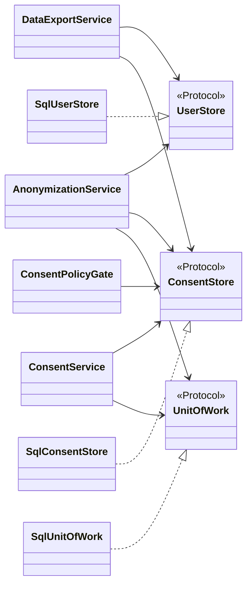

# ЛР №8 — Об'єктно-орієнтований аудит системного дизайну (CK & MOOD)

Проєкт: `Ant228920/LearningEC` · Стек: Python 3.12 / FastAPI / SQLAlchemy · Тести: pytest
Інструменти: SonarQube Community (Docker, :9000), власний `tools/ck_metrics.py`, `tools/coupling_matrix.py`
Git-гілки: `lab8/task2-god-object`, `lab8/task3-inheritance` (від `init/currency-app`)

> Рядки з позначкою **📸 ВСТАВИТИ** — місця для ваших скріншотів.

---

## 0. Важливе застереження щодо інструментів

SonarQube Community Edition **не надає** метрик `class_complexity`, `coupling_between_objects`, `lcom4`, а також DIT та Overridden.
Це доведено самим сервером (запит із цими ключами повертає помилку, див. §1.2). Тому:

- **Sonar Web API** → `complexity`, `cognitive_complexity`, `ncloc`, `functions`, `classes` (аналог WMC на рівні файлу);
- **CK / MOOD / Lorenz–Kidd** (CBO, LCOM4, LCOM\*, DIT, RFC, PIM, Overridden, MHF, AHF, COF) → власний AST-інструмент `tools/ck_metrics.py` (Python `ast`, без залежностей).

Усі числа нижче мають джерело: або сирий JSON Sonar, або JSON, згенерований `ck_metrics.py` (збережені в `docs/lab8/`).

---

## 1. Завдання 1 — Програмний видобуток метрик через REST Web API

### 1.1 Декларація API-запитів

Три файли за ролями (ЛР №6):

| Роль | Файл |
|---|---|
| Core Domain | `my_fastapi_app/api/v1/endpoints/privacy.py` |
| Infrastructure | `my_fastapi_app/repository/currency_repository.py` |
| Utility / DTO | `my_fastapi_app/schemas/privacy.py` |

```powershell
# PowerShell (Windows); токен — у змінній $env:SONAR_TOKEN
$h = @{ Authorization = "Bearer $env:SONAR_TOKEN" }
$base = "http://localhost:9000/api/measures/component"
$keys = "complexity,cognitive_complexity,ncloc,functions,classes"

Invoke-RestMethod -Headers $h "$base?component=LearningEC:my_fastapi_app/api/v1/endpoints/privacy.py&metricKeys=$keys"
Invoke-RestMethod -Headers $h "$base?component=LearningEC:my_fastapi_app/repository/currency_repository.py&metricKeys=$keys"
Invoke-RestMethod -Headers $h "$base?component=LearningEC:my_fastapi_app/schemas/privacy.py&metricKeys=$keys"

# Запит із метриками, яких вимагає методичка:
Invoke-RestMethod -Headers $h "$base?component=LearningEC:my_fastapi_app/schemas/privacy.py&metricKeys=class_complexity,coupling_between_objects,lcom4"
```
> Якщо ви виконували запити через `curl -u $SONAR_TOKEN:` — вставте свої реальні команди замість блоку вище.

### 1.2 Сирі JSON-відповіді Sonar

Файли: `sonar_api_v1_endpoints_privacy.json`, `sonar_repository_currency_repository.json`, `sonar_schemas_privacy.json`, `sonar_missing_*.json`.

```json
{"component":{"key":"LearningEC:my_fastapi_app/api/v1/endpoints/privacy.py","measures":[
 {"metric":"complexity","value":"26"},{"metric":"functions","value":"6"},
 {"metric":"cognitive_complexity","value":"37"},{"metric":"classes","value":"1"},{"metric":"ncloc","value":"255"}]}}
```
```json
{"component":{"key":"LearningEC:my_fastapi_app/repository/currency_repository.py","measures":[
 {"metric":"complexity","value":"4"},{"metric":"functions","value":"3"},
 {"metric":"cognitive_complexity","value":"1"},{"metric":"classes","value":"1"},{"metric":"ncloc","value":"17"}]}}
```
```json
{"component":{"key":"LearningEC:my_fastapi_app/schemas/privacy.py","measures":[
 {"metric":"complexity","value":"0"},{"metric":"functions","value":"0"},
 {"metric":"cognitive_complexity","value":"0"},{"metric":"classes","value":"9"},{"metric":"ncloc","value":"45"}]}}
```
Запит із ключами методички (`sonar_missing_schemas_privacy.json`) — сервер прямо повідомляє, що метрик немає:
```json
{"errors":[{"msg":"The following metric keys are not found: coupling_between_objects, lcom4, class_complexity"}]}
```

### 1.3 Зведена таблиця CK & MOOD (Baseline)

| Файл (роль) | Sonar complexity | Sonar cognitive | ncloc | WMC_module | CBO_module | Ce / Ca | Instability |
|---|---|---|---|---|---|---|---|
| `endpoints/privacy.py` (Core Domain) | 26 | 37 | 255 | 30 | **17** | 3 / 1 | 0.75 |
| `repository/currency_repository.py` (Infrastructure) | 4 | 1 | 17 | 4 | 2 | 1 / 1 | 0.50 |
| `schemas/privacy.py` (Utility/DTO) | 0 | 0 | 45 | 0 | 8 (імена `typing`/`pydantic`) | 0 / 1 | 0.00 |

Класовий рівень (`ck_metrics.py`), приклад Infrastructure: `CurrencyRepository` — WMC 4, CBO 2, LCOM4 1, LCOM\* 0.0, DIT 1, RFC 11, PIM 2.

Глобальні коефіцієнти MOOD (весь проєкт, 23 класи, 12 методів, 80 атрибутів):

| MHF | AHF | COF |
|---|---|---|
| 0.0 % | 1.3 % | 1.8 % |

### 1.4 Первинний архітектурний вердикт

Проєкт загалом зв'язаний слабо (COF 1.8 %), але **вся доменна логіка Privacy/GDPR зосереджена в одному модулі** `privacy.py`:
CBO_module = 17 (поріг > 15), WMC_module = 30, cognitive complexity 37 за 255 рядків, п'ять ендпоінтів, авторизація, SQL-доступ, мапінг та логування в одному файлі.
Це ознака **модуля-мутанта (God Module)**; інші файли — у нормі. Нульовий MHF означає відсутність приховування методів (Python-конвенція без `_`-префіксів у нарахованих класах),
низький AHF — майже всі атрибути публічні. Класу-мутанта в строгому сенсі немає (логіка функціональна), тому в Завд. 2 застосовано дозволений шлях **«штучна агрегація»**.

📸 **ВСТАВИТИ:** скріншот PowerShell із трьома запитами та скріншот дашборду SonarQube.

---

## 2. Завдання 2 — God Object → інтерфейсна декомпозиція

### 2.1 Baseline і Coupling Matrix

Логіку `privacy.py` зібрано в клас `PrivacyManager` (коміт `chore(audit): baseline god object PrivacyManager…`), поведінка не змінена (тести зелені).

| Метрика `PrivacyManager` | Значення | Поріг |
|---|---|---|
| CBO | **18** | > 15 🔴 |
| LCOM\* | **0.945** | → 1 🔴 |
| WMC / RFC / PIM | 37 / 46 / 17 | — |

> `ck_metrics.py` рахує й імена з `typing` (`Any`, `Dict`, `List`); без них «чистий» CBO = 15. До і після міряно однаково, тому порівняння коректне.

SonarQube Community не має вкладки Coupling Matrix, тому матриця побудована `tools/coupling_matrix.py` за списками зв'язків `cbo_classes`.

📸 **ВСТАВИТИ:** `docs/lab8/coupling_matrix_before.png` — рядок `PrivacyManager` з 18 залежностями.

### 2.2 FAIL — Shotgun Surgery

Одна дрібна зміна в «чужому» класі `UserConsent` (`models/users.py`), контракт БД і API не змінено:

```diff
- is_granted = Column(Boolean, default=False, nullable=False)
+ granted = Column("is_granted", Boolean, default=False, nullable=False)
```

God Object ламається у **6 місцях** (`docs/lab8/fail_edit_sites.txt`):

```
privacy.py:38   ConsentPolicyGate.check_consent      UserConsent.is_granted.is_(True)
privacy.py:114  PrivacyManager.export_consents        c.is_granted
privacy.py:172  PrivacyManager.revoke_all_consents    c.is_granted = False
privacy.py:196  PrivacyManager.upsert_consent         consent.is_granted = granted
privacy.py:204  PrivacyManager.upsert_consent         UserConsent(is_granted=...)
privacy.py:217  PrivacyManager.consent_response       consent.is_granted
```

Результат `pytest` (`docs/lab8/fail_pytest.txt`): **8 failed, 9 passed**. Фрагмент:
```
AttributeError: type object 'UserConsent' has no attribute 'is_granted'. Did you mean: 'granted'?
TypeError: 'is_granted' is an invalid keyword argument for UserConsent
```
🔴 **Тихий збій:** присвоєння `c.is_granted = False` у `revoke_all_consents` просто створює звичайний Python-атрибут — анонімізація «успішна», але згоди лишаються активними (порушення GDPR без жодного винятку).

Коміт: `arch(audit): capture god object coupling failure, FAIL`
📸 **ВСТАВИТИ:** скріншот виводу pytest (8 failed).

### 2.3 PASS — Архітектурний Blueprint



| Новий клас | Єдина відповідальність (SRP) | Залежності (через конструктор) |
|---|---|---|
| `DataExportService` | Right of Access, GDPR Art. 15 | `UserStore`, `ConsentStore` |
| `AnonymizationService` | Right to Erasure, GDPR Art. 17, транзакція | `UserStore`, `ConsentStore`, `UnitOfWork` |
| `ConsentService` | видача / відкликання згод | `ConsentStore`, `UnitOfWork` |
| `ConsentPolicyGate` | перевірка активної згоди | `ConsentStore` |
| `Sql*` адаптери | єдине місце, що знає ORM-атрибути | `Session` |

HTTP-шар розбито на `privacy_export / privacy_erasure / privacy_consent` + composition root `privacy_deps.py`; `privacy.py` — агрегатор з тим самим `privacy_router` (`main.py` не змінювався).

Приклад контракту та Dependency Injection (`services/privacy/contracts.py`):
```python
class ConsentStore(Protocol):
    def find(self, user_id: int, purpose: str) -> Optional[ConsentRecord]: ...
    def save(self, record: ConsentRecord) -> ConsentRecord: ...

class ConsentPolicyGate:
    def __init__(self, consents: ConsentStore):   # залежність від абстракції
        self._consents = consents
```

### 2.4 Фінальні метрики CK після рефакторингу

| Клас | WMC | CBO | LCOM4 | LCOM\* | RFC | PIM |
|---|---|---|---|---|---|---|
| ~~PrivacyManager (God Object)~~ | 37 | **18** | 1 | **0.945** | 46 | 17 |
| DataExportService | 5 | 7 | 1 | 0.0 | 13 | 1 |
| AnonymizationService | 5 | 6 | 1 | 0.0 | 16 | 1 |
| ConsentService | 4 | 4 | 1 | 0.0 | 9 | 2 |
| ConsentPolicyGate | 3 | 2 | 1 | 0.0 | 3 | 1 |
| SqlUserStore | 9 | 7 | 1 | 0.0 | 15 | 4 |
| SqlConsentStore | 9 | 5 | 1 | 0.0 | 14 | 4 |
| SqlUnitOfWork | 3 | 1 | 1 | 0.0 | 3 | 2 |

**Max CBO нових класів = 7 (ліміт ≤ 8) ✅ · Max LCOM\* = 0.0 (ліміт ≤ 0.2) ✅ · CBO_module `privacy.py`: 17 → 1.**

| MOOD (проєкт) | Завд. 1 | Baseline Лаб. 8 | Після |
|---|---|---|---|
| Класів | 23 | 24 | 37 |
| COF | 1.8 % | 4.0 % | 2.6 % |
| AHF | 1.3 % | 1.1 % | 11.5 % |
| MHF | 0 % | 0 % | 0 % |

**Та сама зміна `granted` після рефакторингу:** 3 рядки в **одному** файлі-адаптері `sql_adapters.py` (`docs/lab8/pass_edit_sites.txt`) замість 6 місць у 5 методах.
**Тести:** 17 поведінкових (SQLite) + 10 ізольованих unit-тестів сервісів на фейкових портах = **27 passed**.

📸 **ВСТАВИТИ:** `docs/lab8/coupling_matrix_after.png`; скріншот pytest (27 passed).

### 2.5 Sonar після рефакторингу

Повторне сканування виконано. Дані Sonar API для нових файлів, наприклад:
```powershell
Invoke-RestMethod -Headers $h "$base?component=LearningEC:my_fastapi_app/services/privacy/consent.py&metricKeys=complexity,cognitive_complexity,ncloc,functions,classes"
```
📸 **ВСТАВИТИ:** JSON-відповіді (`docs/lab8/sonar_after_*.json`, якщо збережені) і скріншот дашборду.

**Чесно щодо Quality Gate:** статус **Failed** — 6 issues на new code та 0 % покриття new code (Sonar не бачить покриття, бо `coverage.xml` не передається сканеру; тести виключені `sonar.exclusions`). Це не стосується вимог Завд. 2 (CBO/LCOM), які Sonar не вимірює взагалі.

### 2.6 Git History
📸 **ВСТАВИТИ:** `git log --oneline --graph` гілки `lab8/task2-god-object`:
```
refactor(audit): eliminate god object via interface decomposition, PASS
arch(audit): capture god object coupling failure, FAIL
chore(audit): baseline god object PrivacyManager before decomposition
```

### 2.7 Обмеження
1. **LCOM\*:** метрика штрафує допоміжні методи без `self`-атрибутів, тому їх винесено в чисті функції модуля; 0.0 частково відображає цей прийом.
2. Модульний CBO `privacy_consent.py` = 11 та `privacy_deps.py` = 10 перевищує 8, але це контролер / composition root; клас-рівневий ліміт дотримано.
3. Мінімальна зміна поведінки: відмова в доступі тепер логується `warning` у всіх ендпоінтах (раніше лише в експорті).

---

## 3. Завдання 3 — Вертикальний аудит успадкування (Lorenz–Kidd)

### 3.1 Об'єкт аудиту
У проєкті немає ієрархії довжиною ≥ 3, тому за приміткою до завдання створено штучну трирівневу ієрархію експортерів персональних даних
(`services/privacy/exporters.py`): `BaseExporter` → `JsonExporter` → `GdprJsonExporter`.
Поведінка закріплена 10 тестами (`tests/test_exporters_hierarchy.py`), однаковими на всіх станах.

### 3.2 Baseline: протокол Lorenz–Kidd

| Клас | DIT | PIM (власні public) | Перевизначені | Додані |
|---|---|---|---|---|
| BaseExporter | 1 | 10 | 0 | 10 |
| JsonExporter | 2 | 6 | 4 (`build_payload`, `serialize`, `content_type`, `file_name`) | 2 (`to_json`, `parse`) |
| GdprJsonExporter | 3 | 9 | 7 (`validate_subject`, `load_profile`, `build_payload`, `serialize`, `content_type`, `file_name`, `audit`) | 2 (`schema_version`, `legal_basis`) |

- DIT = 3 і 7 перевизначень у листовому класі — нащадок майже повністю переписує поведінку предка; `GdprJsonExporter.build_payload` навіть не викликає `super()`.
- Ефективний публічний інтерфейс `GdprJsonExporter` = 9 власних + 5 успадкованих, не перевизначених = **14**. Орієнтир PIM > 20 **не досягнуто**; ризик підтверджується DIT, обсягом перевизначень та експериментом FAIL.

Коміт: `chore(audit): baseline inheritance hierarchy BaseExporter -> JsonExporter -> GdprJsonExporter`

### 3.3 FAIL — каскадний злам ієрархії

Одна зміна лише в `BaseExporter`: `build_payload(profile, activities, consents)` → `build_payload(bundle)` (разом із викликом у `export`). Нащадків не чіпали.

Результат (`docs/lab8/t3_fail_pytest.txt`) — **4 failed, 6 passed** (`..F.FFF...`):
```
TypeError: JsonExporter.build_payload() missing 2 required positional arguments: 'activities' and 'consents'
TypeError: GdprJsonExporter.build_payload() missing 2 required positional arguments: 'activities' and 'consents'
exporters.py:30  ← рядок у БАТЬКІВСЬКОМУ класі (self.build_payload(bundle))
```
Тести самого `BaseExporter` проходять; падають усі нащадки. `docs/lab8/t3_fail_edit_sites.txt` — 4 місця, які довелося б аварійно синхронізувати вручну:
```
54:  def build_payload(self, bundle)                          # BaseExporter (змінили)
73:  def build_payload(self, profile, activities, consents)   # JsonExporter
74:      payload = super().build_payload(profile, activities, consents)
107: def build_payload(self, profile, activities, consents)   # GdprJsonExporter
```
Python не повідомляє про це при імпорті — лише в момент виклику.

Коміт: `arch(audit): capture inheritance fragility crash, FAIL`
📸 **ВСТАВИТИ:** скріншот виводу `t3_fail_pytest.txt`.

### 3.4 PASS — «Успадкування проти Композиції»

**До** (наслідування):
```python
class BaseExporter: ...
class JsonExporter(BaseExporter): ...
class GdprJsonExporter(JsonExporter): ...
```
**Після** (композиція, Dependency Injection через конструктор, делегування):
```python
class JsonExporter:
    def __init__(self, base: BaseExporter):
        self._base = base
    def build_payload(self, bundle):
        payload = self._base.build_payload(bundle)   # делегування
        payload["format"] = "json"
        return payload

class GdprJsonExporter:
    def __init__(self, json_exporter: JsonExporter, users: UserStore):
        self._json = json_exporter
        self._users = users

def make_gdpr_exporter(users, consents):
    return GdprJsonExporter(make_json_exporter(users, consents), users)
```
Ключове слово наслідування видалено; колишній батько став приватним полем; нащадки звертаються лише до публічного інтерфейсу залежності. Тести не змінювались (створення об'єктів ідe через фабрики `make_*_exporter`).

### 3.5 Фінальний аналітичний звіт

Виконано повторний аналіз (`ck_t3_after.json`):

| Клас | DIT до → після | Overridden до → після | PIM до → після | LCOM\* до → після | CBO |
|---|---|---|---|---|---|
| BaseExporter | 1 → 1 | 0 → 0 | 10 → 10 | 0.889 → 0.889 | 6 → 6 |
| JsonExporter | 2 → **1** | 4 → **0** | 6 → 10 | 1.0 → 0.556 | 4 → 4 |
| GdprJsonExporter | 3 → **1** | 7 → **0** | 9 → **5** | 1.0 → 0.917 | 5 → 5 |

Регресія: `pytest tests/test_exporters_hierarchy.py tests/test_privacy_behavior.py tests/test_privacy_services_isolation.py` → **37 passed**. Статус: **GREEN / PASS**.
Ізоляція змін: тепер така сама зміна сигнатури `BaseExporter.build_payload` потребує правки лише в одному місці — делегуючому виклику `JsonExporter.build_payload`; `GdprJsonExporter` від неї ізольований.

Коміт: `refactor(audit): replace inheritance with composition pattern, PASS`
📸 **ВСТАВИТИ:** скріншот pytest (37 passed) і таблиці CK після (вивід `ck_metrics.py`).

**Про Sonar і DIT:** методичка просить довести DIT=1 через Web API, але SonarQube Community такої метрики не віддає (§0). Інструментальне підтвердження — `tools/ck_metrics.py` (AST); для порівняння можна додати запит Sonar для `exporters.py`:
```powershell
Invoke-RestMethod -Headers $h "$base?component=LearningEC:my_fastapi_app/services/privacy/exporters.py&metricKeys=complexity,cognitive_complexity,ncloc,classes"
```

### 3.6 Git History
📸 **ВСТАВИТИ:** `git log --oneline --graph` гілки `lab8/task3-inheritance`:
```
refactor(audit): replace inheritance with composition pattern, PASS
arch(audit): capture inheritance fragility crash, FAIL
chore(audit): baseline inheritance hierarchy BaseExporter -> JsonExporter -> GdprJsonExporter
```

### 3.7 Обмеження
- Ієрархія створена штучно (за приміткою до завдання) і не підключена до HTTP-ендпоінтів.
- PIM > 20 не досягнуто (максимум 10; ефективний інтерфейс Gdpr до рефакторингу — 14).
- Композиція додала делегуючі методи: PIM `JsonExporter` зріс 6 → 10 — ціна відмови від успадкування.
- LCOM\* лишається високим у `BaseExporter` (0.889) і `GdprJsonExporter` (0.917); це не вимога Завд. 3, але напрям подальшого рефакторингу.

---

## 4. Лог валідації ШІ-Техліда

📸 **ВСТАВИТИ:** протокол проходження краш-тесту «згідно з інструкцією» (текст інструкції — у вашому методичному матеріалі, мені він не передавався).
