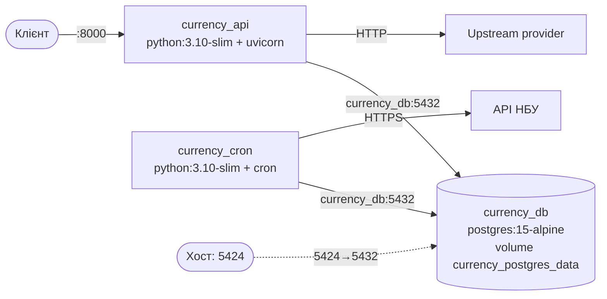

# ISD — Infrastructure Specification Document

**Система:** Currency Converter API · **Версія:** 1.0 · **Дата:** 2026-11-15 · **Власник:** автор репозиторію
**Пов'язані документи:** [SDD](sdd.md) · [ADR-0001](architecture/adr/0001-nbu-sync-via-cron-into-postgres.md) · [ADR-0002](architecture/adr/0002-retry-with-static-fallback.md)

Позначки статусу: **[є]** — реалізовано в репозиторії; **[ціль]** — цільова вимога, ще не реалізована.

## 1. Топологія розгортання

Контейнерна, локальна: усі сервіси піднімає один `docker compose` (`my_fastapi_app/docker-compose.yml`). Хмарного або production-розгортання немає; розділ 3 описує його як цільовий стан.



Порядок підняття: `currency_db` (healthcheck `pg_isready`, інтервал 5 с, 5 спроб) → `currency_api` і `currency_cron` (`depends_on: service_healthy`). Контейнер `currency_api` не має власного healthcheck.

## currency_api

Опис у SDD: [currency_api](sdd.md#31-currency_api--контейнер-застосунку), компоненти C1–C8.

| Параметр | Значення [є] |
|---|---|
| Образ | `python:3.10-slim`, збірка з `my_fastapi_app/Dockerfile` |
| Команда | `uvicorn main:app --host 0.0.0.0 --port 8000 --reload` |
| Порт | `8000:8000` |
| Конфігурація | `env_file: .env` |
| Том | `.:/app` (вихідний код змонтовано в контейнер) |
| Залежності | `currency_db` у стані healthy |

Прапорець `--reload` і монтування коду підходять лише для dev. Для production вони мають бути прибрані (розділ 3).

## currency_db

Опис у SDD: [C10. PostgreSQL](sdd.md#33-currency_db--сховище).

| Параметр | Значення [є] |
|---|---|
| Образ | `postgres:15-alpine` |
| Порт | `5424:5432` (5424 на хості, 5432 усередині мережі compose) |
| Дані | іменований том `currency_postgres_data` → `/var/lib/postgresql/data` |
| Конфігурація | `POSTGRES_USER`, `POSTGRES_PASSWORD`, `POSTGRES_DB` з `.env` |
| Healthcheck | `pg_isready -U ${POSTGRES_USER} -d ${POSTGRES_DB}` |

Застосунок підключається за адресою `DB_HOST=currency_db`, `DB_PORT=5432` (внутрішня мережа compose), а не за `5424`.

## currency_cron

Опис у SDD: [C9. NBU Sync Job](sdd.md#32-currency_cron--завдання-синхронізації).

| Параметр | Значення [є] |
|---|---|
| Образ | той самий `python:3.10-slim` (збірка з `my_fastapi_app`) |
| Команда | `apt-get install cron`, `crontab /etc/cron.d/currency-cron`, `cron -f` |
| Розклад | `0 3 * * *` — щодня о 03:00 за часом контейнера (UTC) |
| Виконання | `cd /app && python -m scripts.sync_nbu >> /var/log/cron.log 2>&1` |
| Файл розкладу | `my_fastapi_app/crontab`, змонтований у `/etc/cron.d/currency-cron`; порожній рядок наприкінці файлу обов'язковий |

Інсталяція `cron` під час кожного старту контейнера потребує доступу до інтернету й сповільнює запуск; рішення — вбудувати `cron` в образ (розділ 3).

## Змінні середовища

Секрети в документі не зберігаються. Шаблон: `my_fastapi_app/.env.example`; робочий файл `.env` створюється копіюванням і не потрапляє в Git (`.gitignore`).

| Змінна | Хто читає | Обов'язкова | Приклад значення |
|---|---|---|---|
| `POSTGRES_USER`, `POSTGRES_PASSWORD`, `POSTGRES_DB` | контейнер `currency_db` | так | `postgres`, `<секрет>`, `currency_converter` |
| `DB_USER`, `DB_PASSWORD`, `DB_NAME`, `DB_HOST`, `DB_PORT` | `core/config.py` (api, cron) | так | `postgres`, `<секрет>`, `currency_converter`, `currency_db`, `5432` |
| `UPSTREAM_PROVIDER_URL` | `endpoints/currency.py` | ні, за замовчуванням `http://localhost:9999/api/rate` | `https://provider.example/api/rate` |
| `SONAR_TOKEN` | сервіс `sonar-scanner` | лише для сканування | не зберігається в репозиторії |

Примітка: `UPSTREAM_PROVIDER_URL` відсутня в `.env.example` і не передається в `docker-compose.yml`. Це розбіжність, зафіксована в аудиті ЛР№10 (вердикт «оновити»).

## 2. Середовища

| Параметр | dev [є] | test [є, локально] | production [ціль] |
|---|---|---|---|
| Запуск | `docker compose up` | `pytest` у `my_fastapi_app/` | `docker compose` або оркестратор без `--reload` |
| База даних | `currency_db` у compose | потрібна доступна БД за `DB_*` (імпорт `main` викликає `create_all`) | окремий інстанс PostgreSQL |
| Код у контейнері | змонтований том | — | зібраний в образ, без тому |
| Секрети | `.env` на машині розробника | `.env` | менеджер секретів / змінні CI, не файл |
| Відкриті порти | 8000, 5424 | — | лише 8000 (або через reverse proxy); 5424 закрито |
| Логування | консоль + `PIISanitizingFilter` | — | централізоване, з фільтром PII |

Тести в CI зараз не запускаються (розділ 4), тож середовище test існує лише локально.

## 3. Цільова конфігурація production [ціль]

1. Прибрати `--reload` і монтування `.:/app`, збирати код в образ.
2. Вбудувати `cron` в образ `currency_cron`, щоб не встановлювати його при старті.
3. Додати `/health` та healthcheck для `currency_api`.
4. Передавати `UPSTREAM_PROVIDER_URL` у compose і додати її в `.env.example`.
5. Не публікувати порт бази на хост.
6. Секрети зберігати поза репозиторієм і поза образом.

## 4. CI/CD-конвейєр

Опис у SDD: [C11. Quality tooling](sdd.md#34-інструменти-якості).

Файл: `.github/workflows/complexity-audit.yml`, робоча назва «Complexity & Hotspots Audit». Статус [є].

| Тригери | `push`, `pull_request`, `workflow_dispatch` |
|---|---|
| Раннер | `ubuntu-latest`, контейнер `python:3.12`, права `contents: read` |

| # | Стадія | Дія |
|---|---|---|
| 1 | Checkout | `actions/checkout@v4`, `fetch-depth: 0` (повна історія для churn) |
| 2 | Safe directory | `git config --global --add safe.directory` |
| 3 | Install scanners | `pip install radon lizard` |
| 4 | Scan | `radon cc -s -j .` → `reports/radon-cc.json`, `lizard . --csv` → `reports/lizard.csv` |
| 5 | Git churn | зміни за 90 днів → `reports/churn-90d.txt` |
| 6 | Hotspots | `python tools/hotspots.py` → матриця |
| 7 | Summary | матриця додається в `$GITHUB_STEP_SUMMARY` |
| 8 | Artifact | `actions/upload-artifact@v4`, `if-no-files-found: error` |

**Quality Gates**

| Gate | Де працює | Умова |
|---|---|---|
| Цикломатична складність | pre-commit (`check_cc.py`, radon) | CC ≤ 10, інакше коміт заблоковано |
| Секрети в коді | pre-commit (`gitleaks` v8.18.2) | знайдений секрет блокує коміт |
| Артефакт звіту | CI, стадія 8 | відсутність звітів завалює збірку |

Обмеження, зафіксовані чесно: конвеєр лише вимірює метрики, **не запускає тести** і **не розгортає** систему (CD відсутній). Gates складності й gitleaks працюють локально на pre-commit, у CI вони не продубльовані.

## sonarqube

Допоміжна інфраструктура якості, `docker-compose.sonar.yml` у корені репозиторію [є].

| Параметр | Значення |
|---|---|
| Сервіси | `sonarqube` (`sonarqube:community`, порт 9000, три іменовані томи), `sonar-scanner` (профіль `scan`) |
| Конфігурація сканування | `sonar-project.properties`: `sources=my_fastapi_app`, виключено `tests`, `scripts`, Python 3.12 |
| Токен | `SONAR_TOKEN` з середовища, не зберігається в репозиторії |

## 5. Моніторинг

| Що | Стан | Як |
|---|---|---|
| Журнал застосунку | [є] | стандартний `logging`, фільтр `PIISanitizingFilter` маскує email, телефони, токени |
| Журнал синхронізації | [є] | `/var/log/cron.log` у контейнері `currency_cron` |
| Стан деградації для клієнта | [є] | поле `system_status` у відповіді конвертації |
| Навантажувальна перевірка | [є] | `load_test.js` (k6), пороги `p95 < 200 мс`, `помилки < 1 %` |
| Health endpoint | [ціль] | `GET /health` з перевіркою з'єднання з БД |
| Сповіщення | [ціль] | алерт, якщо `sync_nbu` повертає код 1 або `system_status = degraded_fallback` понад заданий час |

## 6. Резервне копіювання та відновлення

**Поточний стан:** автоматичних бекапів немає. Дані зберігаються лише в томі `currency_postgres_data`. Це прогалина, зафіксована в паспорті.

**Цільові значення [ціль]:**

| Показник | Значення | Обґрунтування |
|---|---|---|
| **RPO** (допустима втрата даних) | 24 години | Курси відновлюються синхронізацією з НБУ щодоби; єдині незамінні дані — таблиці `users`, `user_activities`, `user_consents` |
| **RTO** (допустимий час відновлення) | 1 година | Відновлення з дампу в новий контейнер `postgres:15-alpine` і перезапуск `currency_api` |

**Процедура резервного копіювання (щодоби, після синхронізації о 03:00, наприклад 03:30):**
```bash
docker compose exec -T currency_db pg_dump -U "$POSTGRES_USER" "$POSTGRES_DB" \
  | gzip > backup_$(date +%F).sql.gz
```
Зберігати 7 останніх копій поза хостом із базою.

**Відновлення:**
```bash
docker compose up -d currency_db
gunzip -c backup_YYYY-MM-DD.sql.gz | docker compose exec -T currency_db \
  psql -U "$POSTGRES_USER" "$POSTGRES_DB"
docker compose up -d currency_api currency_cron
```
Після відновлення дочекатися найближчої синхронізації або запустити її вручну: `docker compose exec currency_cron python -m scripts.sync_nbu`.

**Відкат релізу:** повернутися на попередній тег/коміт (`git checkout <тег>`), перебудувати образи `docker compose up -d --build`. Оскільки міграцій схеми немає (SDD, розбіжність 5), відкат схеми потребує відновлення з дампу.

## 7. Відповідність компонентів SDD та ISD

| Компонент SDD | Розділ ISD |
|---|---|
| C1–C8 (currency_api) | [currency_api](#currency_api) |
| C9 (NBU Sync Job) | [currency_cron](#currency_cron) |
| C10 (PostgreSQL) | [currency_db](#currency_db) |
| C11 (Quality tooling) | [CI/CD-конвейєр](#4-cicd-конвейєр), [sonarqube](#sonarqube) |
