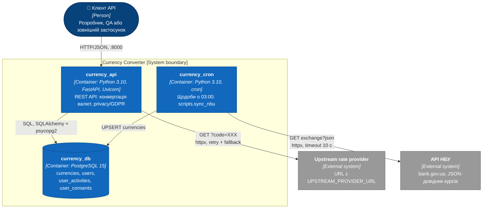
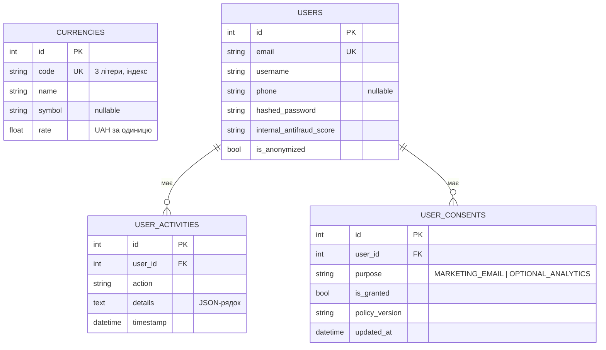

# SDD — System Design Document

**Система:** Currency Converter API (`my_fastapi_app/`)
**Версія документа:** 1.0 · **Дата:** 2026-11-15 · **Власник:** автор репозиторію
**Пов'язані документи:** [ISD](isd.md) · [ADR-0001](architecture/adr/0001-nbu-sync-via-cron-into-postgres.md) · [ADR-0002](architecture/adr/0002-retry-with-static-fallback.md)

## 1. Призначення та межі системи

Сервіс конвертує суму з однієї валюти в іншу за крос-курсом. Курси беруться з локальної бази PostgreSQL, яку щодоби наповнює завдання синхронізації з API Національного банку України (НБУ). Якщо валюти немає в базі, сервіс звертається до зовнішнього провайдера курсів, а при його недоступності повертає запасне (fallback) значення і позначає відповідь як `degraded_fallback`.
Додатково сервіс має модуль приватності (GDPR): експорт персональних даних, анонімізація, керування згодами.

Поза межами системи: автентифікація (ідентифікатор користувача передається заголовком `X-User-Id` без перевірки), реальне надсилання листів (маркетингова дія лише імітується), фронтенд.

## 2. Діаграма контейнерів (C4, рівень 2)

Нотація C4 (Person, Container, External system), записана синтаксисом `flowchart` Mermaid: рідний `C4Container` Mermaid розміщує елементи неохайно, а `flowchart` однаково відображається в GitHub, Obsidian і Notion.

Інфраструктурні контейнери (SonarQube, scanner) та CI не входять до продуктової діаграми, їх описано в [ISD](isd.md#sonarqube).

## 3. Компоненти

Кожен компонент перелічує, з ким взаємодіє, і має посилання на опис розгортання в ISD.

### 3.1 currency_api — контейнер застосунку
Точка входу `main.py` (composition root): створює `FastAPI`, підключає роутери з префіксом `/api/v1`, налаштовує безпечне логування, під час імпорту викликає `Base.metadata.create_all`. Розгортання: [ISD → currency_api](isd.md#currency_api).

| Підкомпонент | Відповідальність | Ключові залежності | Взаємодіє з |
|---|---|---|---|
| **C1. Router (`api/api.py`)** | Збирає роутери версії API | FastAPI | C2 |
| **C2. Currency Endpoint (`api/v1/endpoints/currency.py`)** | Валідація запиту, обчислення крос-курсу, статус `healthy`/`degraded_fallback` | C6, C4, C7 | C1, C4, C6, C7, зовнішній Upstream |
| **C3. Privacy Module (`api/v1/endpoints/privacy.py`, `schemas/privacy.py`)** | Експорт даних (GDPR ст. 15), анонімізація, grant/revoke згод, Policy Gate для маркетингу | C7, `models/users.py` | C5, C7 |
| **C4. Resilience Service (`core/resilience_service.py`)** | `RateRequest`, `RetryPolicy` (3 спроби, backoff 0.1/0.2 с, таймаут 0.4 с), таблиця `FALLBACK_RATES` | httpx | C2, Upstream |
| **C5. Secure Logger (`core/secure_logger.py`)** | Фільтр, що маскує email, телефони, токени й паролі в логах | logging | C3, C2 та інші модулі, що логують |
| **C6. CurrencyRepository (`repository/currency_repository.py`)** | `get_by_code`, `upsert_currencies` | C7, SQLAlchemy | C2, C9 |
| **C7. Persistence (`db/session.py`, `models/*`)** | Engine, сесії (`get_db`), ORM-моделі | C8, SQLAlchemy | C2, C3, C6, C10 |
| **C8. Config (`core/config.py`)** | Читає `DB_*` із середовища/`.env` (pydantic-settings) | pydantic-settings | C7 |

Змінні середовища компонента: [ISD → Змінні середовища](isd.md#змінні-середовища).

### 3.2 currency_cron — завдання синхронізації
**C9. NBU Sync Job (`scripts/sync_nbu.py`, `crontab`).** Завантажує курси НБУ, фільтрує некоректні записи й заборонені коди (`RUB`, `BYN`), додає `UAH = 1.0`, записує в базу через C6. Код завершення: `0` успіх, `1` помилка. Рішення: [ADR-0001](architecture/adr/0001-nbu-sync-via-cron-into-postgres.md). Взаємодіє з: C6, C7, API НБУ, C10. Розгортання: [ISD → currency_cron](isd.md#currency_cron).

### 3.3 currency_db — сховище
**C10. PostgreSQL 15 (`postgres:15-alpine`).** Єдине сховище даних. Взаємодіє з: C7 (з `currency_api`), C9 (з `currency_cron`). Розгортання: [ISD → currency_db](isd.md#currency_db).

### 3.4 Інструменти якості
**C11. Quality tooling.** Pre-commit (gitleaks, radon CC ≤ 10), GitHub Actions «Complexity & Hotspots Audit», SonarQube. Не впливають на роботу API. Розгортання: [ISD → CI/CD-конвейєр](isd.md#4-cicd-конвейєр), [ISD → sonarqube](isd.md#sonarqube).

## 4. Модель даних

Примітки: `currencies` не пов'язана з `users`. Схема створюється автоматично під час старту (`create_all`), міграцій Alembic немає (бібліотека є в `requirements.txt`, але не використовується).

## 5. API-контракти

### 5.1 Зовнішні (HTTP, префікс `/api/v1`)

| Метод і шлях | Вхід | Відповідь | Коди | Компонент |
|---|---|---|---|---|
| `GET /api/v1/tasks/api/convert` | query: `amount` > 0, `from_currency` (3 символи), `to_currency` (3 символи) | `{from_currency, to_currency, amount, converted_amount, cross_rate, system_status}` | 200, 422 | C2 |
| `GET /api/v1/users/{user_id}/personal-data` | header `X-User-Id` | `PersonalDataExportResponse` (профіль, активність, згоди) | 200, 403, 404 | C3 |
| `POST /api/v1/users/{user_id}/anonymize` | header `X-User-Id` | `{status, message, user_id, anonymized_at}`, ідемпотентно | 200, 403, 404, 500 | C3 |
| `POST /api/v1/users/{user_id}/consents/grant` | header + `{purpose, policy_version}` | `ConsentActionResponse` | 200, 403, 422 | C3 |
| `POST /api/v1/users/{user_id}/consents/revoke` | header + `{purpose, policy_version}` | `ConsentActionResponse` | 200, 403, 422 | C3 |
| `POST /api/v1/users/{user_id}/actions/send-marketing` | header + `{campaign_name, message}` | `{status: "ALLOW", action, campaign}` | 200, 403 (Policy Gate DENY) | C3 |
| `POST /api/v1/auth/test-login-log` | довільний JSON | `{status: "ok"}`, демонстрація маскування логів | 200 | C5 (у `main.py`) |

Поле `system_status` приймає значення `healthy` або `degraded_fallback`. Права доступу: `user_id` у шляху має збігатися з `X-User-Id`, інакше 403.

### 5.2 Внутрішні та зовнішні інтеграційні контракти

| Контракт | Сторони | Формат |
|---|---|---|
| Запит курсу до провайдера | C4 → Upstream | `GET {UPSTREAM_PROVIDER_URL}?code=XXX` → `{"rate": <float>}`; таймаут 0.4 с, connect 0.2 с, 3 спроби |
| Завантаження курсів НБУ | C9 → НБУ | `GET https://bank.gov.ua/NBUStatService/v1/statdirectory/exchange?json` → масив `{cc, txt, rate}`; таймаут 10 с |
| Запуск синхронізації | cron → C9 | `python -m scripts.sync_nbu`, exit code 0 / 1 |
| Доступ до даних | C2, C9 → C6 | `get_by_code(code) -> Currency \| None`, `upsert_currencies(list[dict])` |

## 6. Відомі розбіжності й технічний борг

Документ описує систему такою, якою вона є в коді на 2026-11-15. Відхилення, виявлені під час складання паспорта:

| # | Спостереження | Наслідок |
|---|---|---|
| 1 | Роутер конвертації підключено з префіксом `/tasks` і тегом `Tasks` (`api/api.py`), тож реальний шлях `/api/v1/tasks/api/convert` | Назва шляху не відповідає предметній області (залишок від проєкту `todo/`) |
| 2 | У `main.py` назва застосунку `"TODO List API"`, опис «управління завданнями» | Swagger показує невірну назву системи |
| 3 | `upsert_currencies` викликає `on_conflict_do_update(index_elements=['code'])` без `set_`. На SQLAlchemy 2.x це кидає `ValueError`, а `sync_nbu` перехоплює помилку й повертає код 1 | Таблиця `currencies` не наповнюється, конвертація працює через Upstream або fallback. **Потребує перевірки запуском на реальній БД** |
| 4 | `X-User-Id` приймається без автентифікації | Будь-хто, хто знає `user_id`, може діяти від його імені (поза межами навчального проєкту, але ризик задекларовано) |
| 5 | Схема БД створюється `create_all` під час імпорту `main`; міграцій немає | Зміни схеми не версіонуються |
| 6 | Ендпоінт `/auth/test-login-log` приймає довільні дані та логує їх | Демонстраційний, не для production |
| 7 | `UPSTREAM_PROVIDER_URL` має значення за замовчуванням `http://localhost:9999/...`, а в `docker-compose.yml` змінну не передано | У контейнері `localhost` вказує на сам контейнер, тож провайдер недоступний, і працює fallback |
